# ssm酒店管理系统hsg7206Y3程序

> 🎓 **计算机毕业设计 · ssm酒店管理系统hsg7206Y3程序**
>
> 本仓库只放**项目介绍 + 运行截图**（截图是站点带水印的原图，存在仓库 `images/` 里）。
>
> 👉 **完整可运行源码 / 数据库脚本 / 部署文档：[点我获取](https://geekcode.top/archives/ssm%E9%85%92%E5%BA%97%E7%AE%A1%E7%90%86%E7%B3%BB%E7%BB%9Fhsg7206Y3%E7%A8%8B%E5%BA%8F?utm_source=github)**
>
> 💬 咨询微信：**ir9372**　|　🌐 更多项目：[极客代码 geekcode.top](https://geekcode.top/?utm_source=github)
>
> 📌 项目详情页：<https://geekcode.top/archives/ssm%E9%85%92%E5%BA%97%E7%AE%A1%E7%90%86%E7%B3%BB%E7%BB%9Fhsg7206Y3%E7%A8%8B%E5%BA%8F?utm_source=github>

<table><td width="230" align="center"> <b>扫码加微信 ir9372</b></td><td valign="middle">📦 源码 = 项目介绍 + 全部运行截图 + 数据库 + 部署文档 👉 点上方任意截图，直接跳到 <b>极客代码 geekcode.top</b> 详情页</td></table>

---

<h1>ssm酒店管理系统hsg7206Y3程序</h1>
<h2>项目概述</h2>

本项目名为“ssm酒店管理系统”，旨在为中小型酒店提供一套基于Web的数字化管理解决方案。系统核心目标是实现酒店日常运营流程的电子化与规范化，涵盖客房信息管理、客户登记、预订入住、退房结算及财务统计等关键环节。适用人群主要为酒店前台接待人员、管理人员及财务人员。技术架构采用经典的Java Web开发模式，后端基于SSM（Spring + Spring MVC + MyBatis）框架进行业务逻辑处理与数据持久化，前端使用JSP页面进行动态渲染与交互展示，数据库选用MySQL存储业务数据。通过该系统，酒店能够有效提升服务效率，减少人工记录错误，并实现对经营数据的实时监控与分析。

<h2>技术架构</h2>

本系统采用分层架构设计，确保代码的可维护性与扩展性。

<strong>1. 后端架构</strong>

<ul>
<li><strong>表现层 (Controller)</strong>：基于Spring MVC构建，负责接收HTTP请求，解析参数，调用Service层处理业务逻辑，并将结果转发至JSP视图或返回JSON数据。</li>
<li><strong>业务逻辑层 (Service)</strong>：封装具体的业务规则，如入住校验、费用计算、状态流转等，保证事务的一致性。</li>
<li><strong>数据访问层 (DAO/Mapper)</strong>：使用MyBatis框架，通过XML映射文件或注解方式定义SQL语句，实现与MySQL数据库的高效交互。</li>
<li><strong>容器与框架</strong>：利用Spring IoC容器管理Bean的生命周期与依赖注入，AOP切面用于日志记录或权限控制（如有）。</li>
</ul>

<strong>2. 前端架构</strong>

<ul>
<li><strong>视图技术</strong>：采用JSP (JavaServer Pages) 技术，结合HTML、CSS和JavaScript构建用户界面。JSP页面在服务端渲染后发送给浏览器，便于快速开发和服务器端数据绑定。</li>
<li><strong>交互逻辑</strong>：通过JavaScript处理表单验证、Ajax异步请求等前端交互行为。</li>
</ul>

<strong>3. 数据库设计要点</strong>

<ul>
<li>数据库选型为MySQL，遵循第三范式进行表结构设计。</li>
<li>主要实体包括：用户信息、员工信息、客房信息、客户信息、预订记录、入住记录、消费记录、结账记录及财务报表数据。</li>
<li>各表之间通过外键建立关联，例如“入住记录”关联“客房信息”与“客户信息”，“消费记录”关联“入住记录”，确保数据引用的完整性。</li>
</ul>
<h2>功能模块</h2>

根据截图所示的功能列表，系统主要包含以下核心模块：

<strong>1. 系统登录模块</strong>

<ul>
<li><strong>登录页</strong>：提供用户身份认证入口，输入账号密码进入系统主界面。</li>
</ul>

<strong>2. 基础信息管理模块</strong>

<ul>
<li><strong>用户管理 (allusers)</strong>：查看、编辑所有系统用户的基本信息，支持用户信息的更新操作 (<code>allusersupdt</code>)。</li>
<li><strong>员工信息管理 (yuangongxinxi)</strong>：录入和维护酒店员工的个人资料、职位等信息。</li>
<li><strong>客房信息管理 (kefangxinxi)</strong>：管理酒店的房间资源，包括房间号、类型、状态（空闲/占用）、价格等属性的增删改查。</li>
<li><strong>客户信息管理 (lvkexinxi)</strong>：记录入住客户的身份信息、联系方式等详细资料。</li>
</ul>

<strong>3. 业务流程管理模块</strong>

<ul>
<li><strong>预订管理 (yuding)</strong>：处理客户的客房预订请求，记录预订时间、预计入住时长等信息。</li>
<li><strong>入住管理 (ruzhu)</strong>：办理客户正式入住手续，将预订状态转为入住状态，分配具体房间。</li>
<li><strong>消费管理 (xiaofei)</strong>：记录客户在住宿期间产生的各项额外消费（如餐饮、洗衣等），关联到对应的入住订单。</li>
<li><strong>退房管理 (tuifang)</strong>：办理客户退房手续，触发费用结算流程，释放客房资源。</li>
<li><strong>结账管理 (jiezhang)</strong>：对退房后的账单进行最终确认与支付处理，生成结账单据。</li>
</ul>

<strong>4. 统计分析模块</strong>

<ul>
<li><strong>财务统计 (caiwutongji)</strong>：汇总和分析酒店的营收数据，支持按时间段、房型等维度查看报表，并提供统计信息的修改或导出功能 (<code>caiwutongjiupdt</code>)。</li>
</ul>
<h2>用户角色与权限</h2>

根据提供的上下文信息，项目中未明确列出复杂的角色权限矩阵或后台路由配置。截图中出现的 <code>admin</code> 标识暗示存在管理员视角，但具体的角色划分（如普通员工、经理、超级管理员）及其对应的细粒度权限控制在现有信息中无法确定。

基于常规酒店管理系统的设计逻辑及截图中的功能覆盖范围，可推断系统至少包含以下两类潜在用户群体：

<ol>
<li><strong>系统管理员/高层管理者</strong>：</li>
</ol>
<ul>
<li>拥有最高权限，可访问所有模块。</li>
<li>重点功能：用户管理、员工信息管理、财务统计查看与修正。</li>
</ul>
<ol start="2">
<li><strong>前台工作人员/操作员</strong>：</li>
</ol>
<ul>
<li>负责日常业务处理。</li>
<li>重点功能：客房信息查询、客户信息录入、预订处理、入住办理、消费记录添加、退房与结账操作。</li>
</ul>

<em>注：由于缺乏明确的RBAC（基于角色的访问控制）代码上下文或菜单配置文档，上述权限分配仅基于功能模块的业务属性进行逻辑归类，具体权限边界以实际部署配置为准。</em>

<h2>项目特色与创新点</h2>
<ol>
<li><strong>全流程闭环管理</strong>：系统覆盖了从“预订-入住-消费-退房-结账”的完整酒店业务生命周期，各环节数据自动流转，减少了重复录入工作，提升了业务处理的连贯性。</li>
<li><strong>数据驱动的财务分析</strong>：内置专门的“财务统计”模块，能够将分散的消费记录和结账数据进行聚合，为管理层提供直观的营收报表，辅助经营决策。</li>
<li><strong>经典稳定的技术栈</strong>：采用成熟的SSM+JSP组合，技术体系稳定，社区资源丰富，对于毕业设计而言，易于理解与维护，能够清晰展示Java Web开发的分层思想与设计模式应用。</li>
<li><strong>资源状态实时同步</strong>：客房信息与入住状态的联动更新，确保了房态图的准确性，避免了超订或漏订情况的发生。</li>
</ol>
<h2>部署环境</h2>

为确保系统正常运行，需准备以下软件环境：

<ol>
<li><strong>操作系统</strong>：Windows 7/10/11 或 Linux (CentOS/Ubuntu)。</li>
<li><strong>Java运行环境</strong>：JDK 1.8 或以上版本（建议 JDK 1.8，兼容性好）。</li>
<li><strong>Web服务器</strong>：Apache Tomcat 8.5 或 9.0（作为Servlet容器运行JSP和Java类）。</li>
<li><strong>数据库</strong>：MySQL 5.7 或 MySQL 8.0（需导入项目初始化的SQL脚本以创建表和基础数据）。</li>
<li><strong>开发工具</strong>（可选，用于二次开发或调试）：</li>
</ol>
<ul>
<li>IDE：IntelliJ IDEA 或 Eclipse。</li>
<li>构建工具：Maven（用于依赖管理和项目构建）。</li>
</ul>
<ol start="6">
<li><strong>浏览器</strong>：Chrome, Firefox, Edge 等主流现代浏览器（推荐Chrome以获得最佳JSP渲染效果）。</li>
</ol>
<h2>五、技术特性</h2>
<ul>
<li>服务端模板渲染（JSP）</li>
</ul>
<h2>六、功能模块截图</h2>
<h3>前台用户端</h3>
<h4>页面-jiezhang列表</h4>

<a href="https://geekcode.top/archives/ssm%E9%85%92%E5%BA%97%E7%AE%A1%E7%90%86%E7%B3%BB%E7%BB%9Fhsg7206Y3%E7%A8%8B%E5%BA%8F?utm_source=github" title="查看完整源码">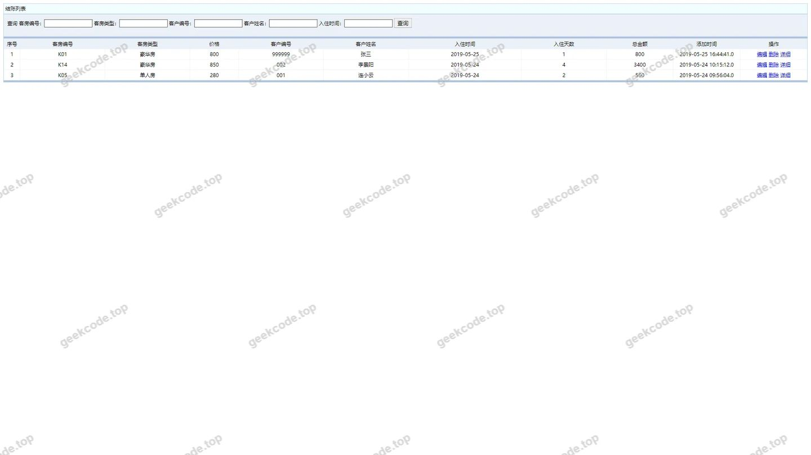</a>

<h4>页面-kefangxinxi列表</h4>

<a href="https://geekcode.top/archives/ssm%E9%85%92%E5%BA%97%E7%AE%A1%E7%90%86%E7%B3%BB%E7%BB%9Fhsg7206Y3%E7%A8%8B%E5%BA%8F?utm_source=github" title="查看完整源码">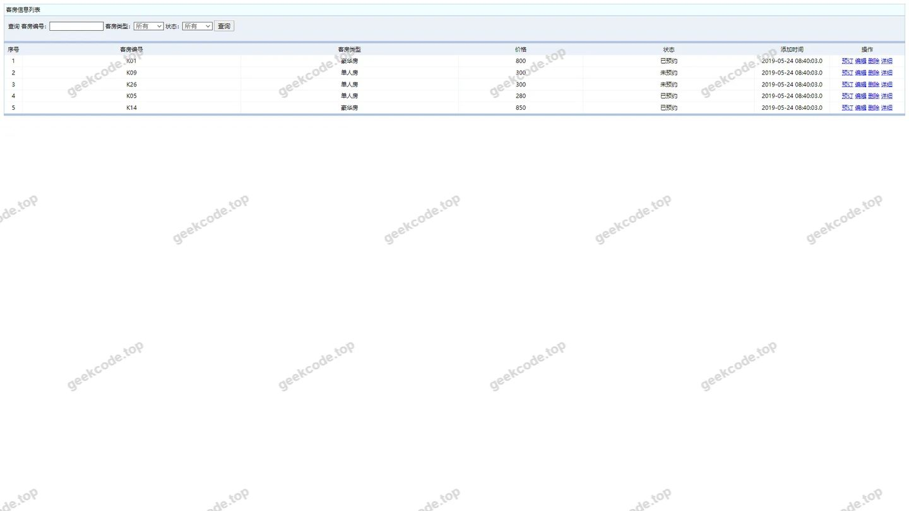</a>

<h4>页面-lvkexinxi列表</h4>

<a href="https://geekcode.top/archives/ssm%E9%85%92%E5%BA%97%E7%AE%A1%E7%90%86%E7%B3%BB%E7%BB%9Fhsg7206Y3%E7%A8%8B%E5%BA%8F?utm_source=github" title="查看完整源码">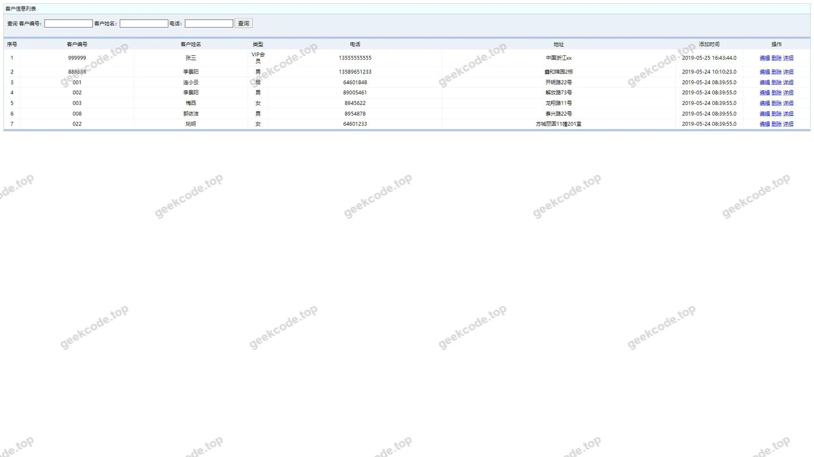</a>

<h4>页面-ruzhu列表</h4>

<a href="https://geekcode.top/archives/ssm%E9%85%92%E5%BA%97%E7%AE%A1%E7%90%86%E7%B3%BB%E7%BB%9Fhsg7206Y3%E7%A8%8B%E5%BA%8F?utm_source=github" title="查看完整源码">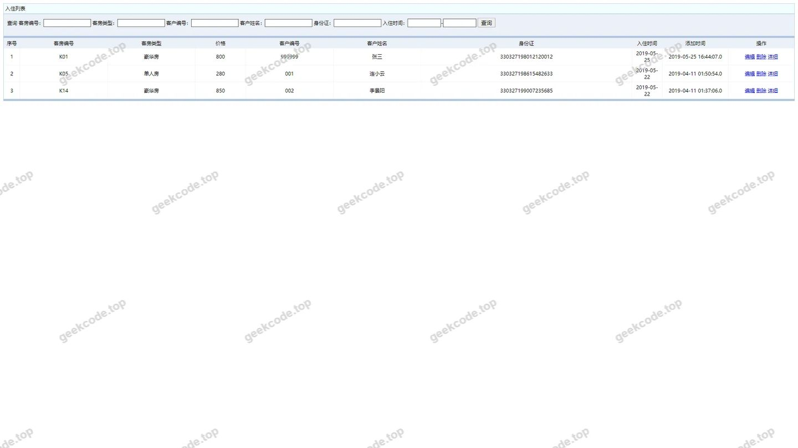</a>

<h4>页面-tuifang列表</h4>

<a href="https://geekcode.top/archives/ssm%E9%85%92%E5%BA%97%E7%AE%A1%E7%90%86%E7%B3%BB%E7%BB%9Fhsg7206Y3%E7%A8%8B%E5%BA%8F?utm_source=github" title="查看完整源码">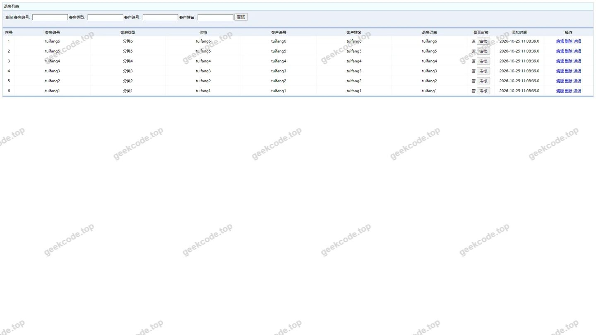</a>

<h4>页面-xiaofei列表</h4>

<a href="https://geekcode.top/archives/ssm%E9%85%92%E5%BA%97%E7%AE%A1%E7%90%86%E7%B3%BB%E7%BB%9Fhsg7206Y3%E7%A8%8B%E5%BA%8F?utm_source=github" title="查看完整源码">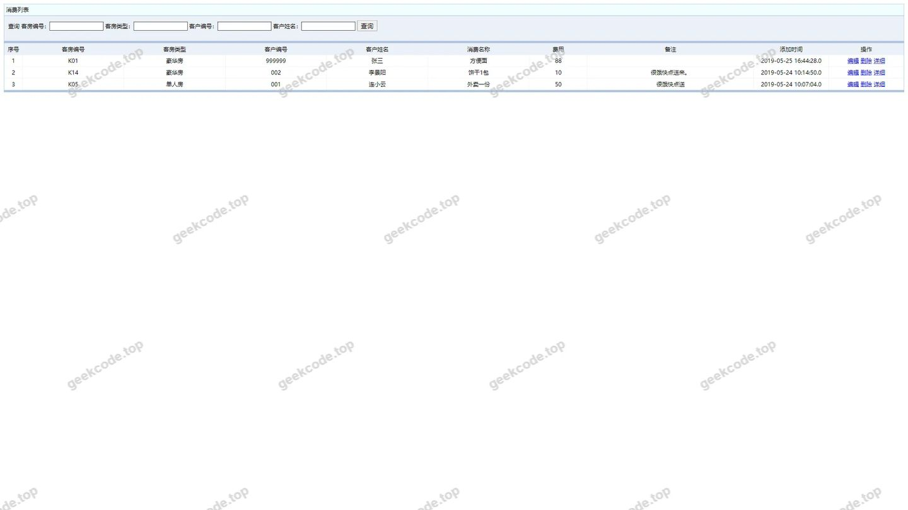</a>

<h4>页面-yuangongxinxi列表</h4>

<a href="https://geekcode.top/archives/ssm%E9%85%92%E5%BA%97%E7%AE%A1%E7%90%86%E7%B3%BB%E7%BB%9Fhsg7206Y3%E7%A8%8B%E5%BA%8F?utm_source=github" title="查看完整源码">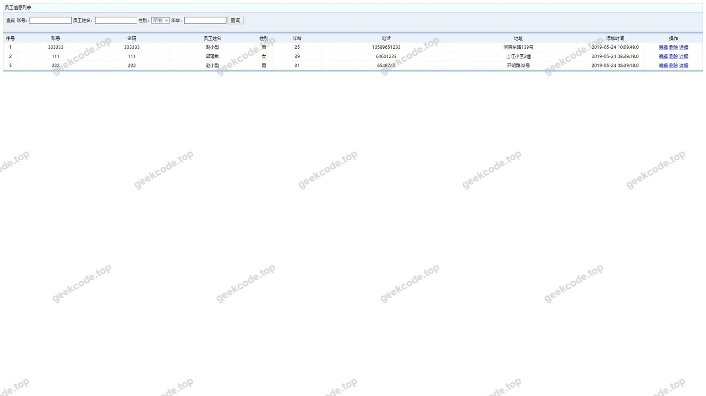</a>

<h4>页面-yuding列表</h4>

<a href="https://geekcode.top/archives/ssm%E9%85%92%E5%BA%97%E7%AE%A1%E7%90%86%E7%B3%BB%E7%BB%9Fhsg7206Y3%E7%A8%8B%E5%BA%8F?utm_source=github" title="查看完整源码">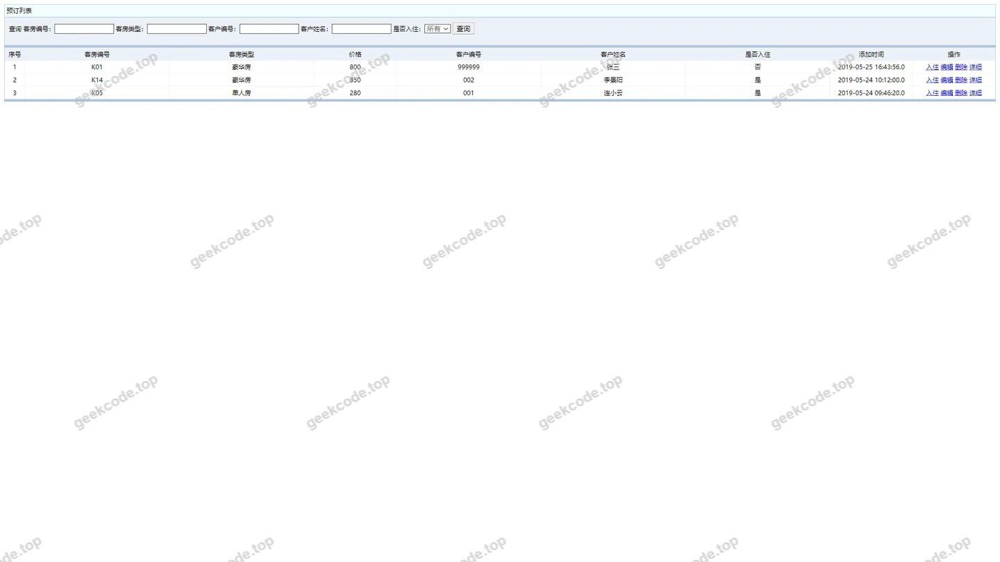</a>

<h3>后台管理端</h3>
<h4>页面-编辑</h4>

<a href="https://geekcode.top/archives/ssm%E9%85%92%E5%BA%97%E7%AE%A1%E7%90%86%E7%B3%BB%E7%BB%9Fhsg7206Y3%E7%A8%8B%E5%BA%8F?utm_source=github" title="查看完整源码">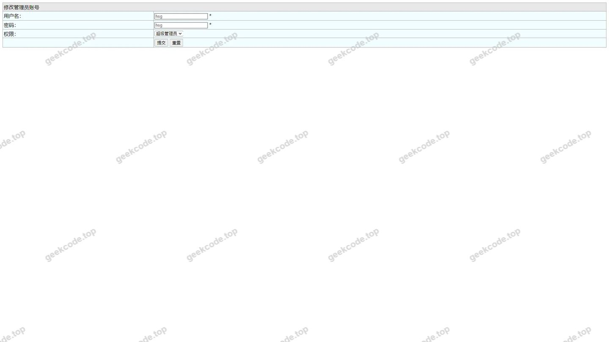</a>

<h4>登录页</h4>

<a href="https://geekcode.top/archives/ssm%E9%85%92%E5%BA%97%E7%AE%A1%E7%90%86%E7%B3%BB%E7%BB%9Fhsg7206Y3%E7%A8%8B%E5%BA%8F?utm_source=github" title="查看完整源码">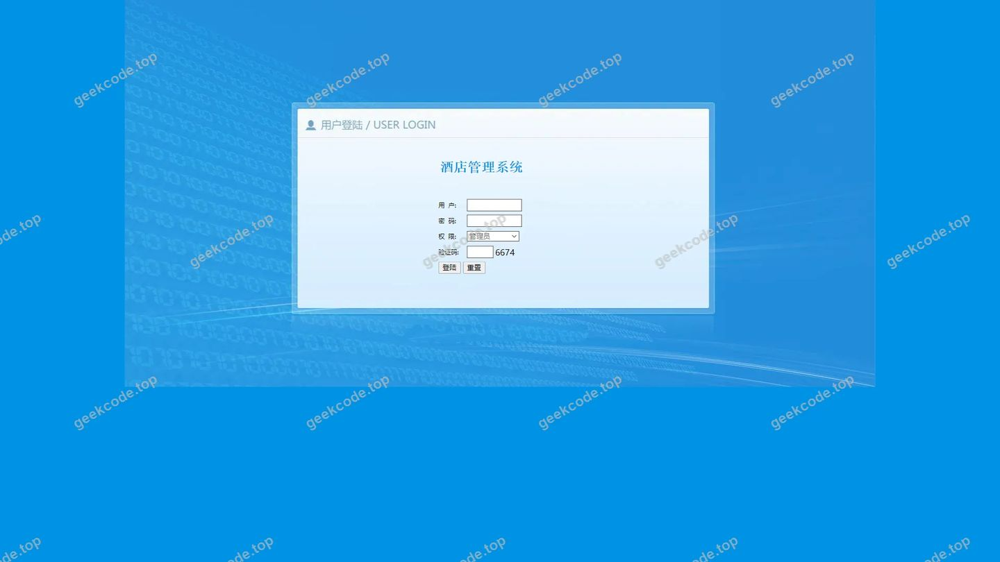</a>

<h4>页面-allusersupdt</h4>

<h4>页面-allusers列表</h4>

<a href="https://geekcode.top/archives/ssm%E9%85%92%E5%BA%97%E7%AE%A1%E7%90%86%E7%B3%BB%E7%BB%9Fhsg7206Y3%E7%A8%8B%E5%BA%8F?utm_source=github" title="查看完整源码">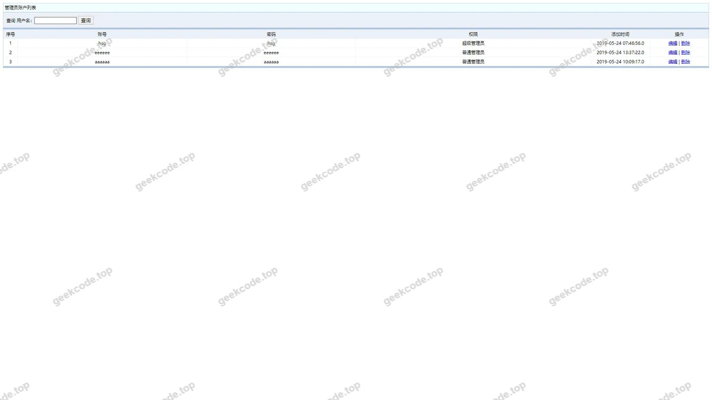</a>

<h4>页面-caiwutongjiupdt</h4>

<a href="https://geekcode.top/archives/ssm%E9%85%92%E5%BA%97%E7%AE%A1%E7%90%86%E7%B3%BB%E7%BB%9Fhsg7206Y3%E7%A8%8B%E5%BA%8F?utm_source=github" title="查看完整源码">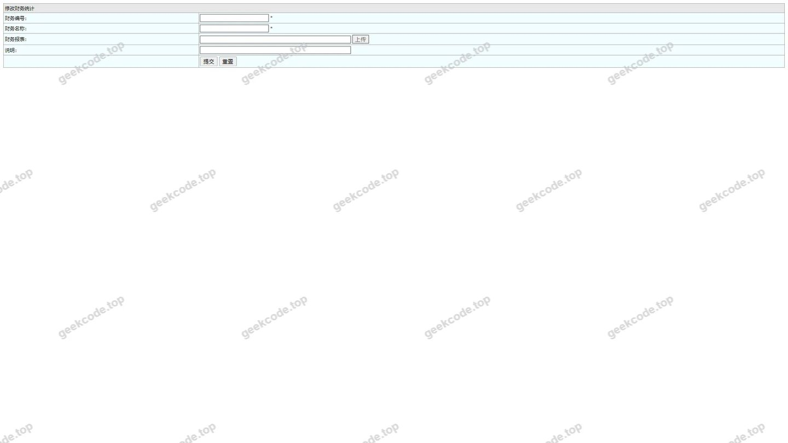</a>

<h4>页面-caiwutongji列表</h4>

<a href="https://geekcode.top/archives/ssm%E9%85%92%E5%BA%97%E7%AE%A1%E7%90%86%E7%B3%BB%E7%BB%9Fhsg7206Y3%E7%A8%8B%E5%BA%8F?utm_source=github" title="查看完整源码">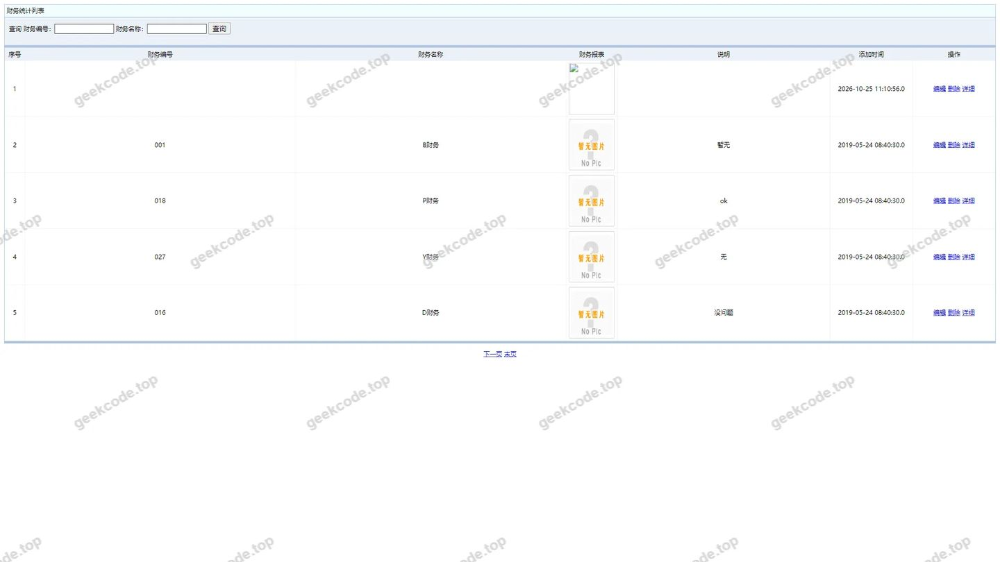</a>

---

## 获取完整源码

| 项目 | 说明 |
| --- | --- |
| 项目名 | ssm酒店管理系统hsg7206Y3程序 |
| 运行截图 | 本文 14 张（站点带水印原图，仓库 `images/` 目录） |
| 完整源码 | [https://geekcode.top/archives/ssm%E9%85%92%E5%BA%97%E7%AE%A1%E7%90%86%E7%B3%BB%E7%BB%9Fhsg7206Y3%E7%A8%8B%E5%BA%8F?utm_source=github](https://geekcode.top/archives/ssm%E9%85%92%E5%BA%97%E7%AE%A1%E7%90%86%E7%B3%BB%E7%BB%9Fhsg7206Y3%E7%A8%8B%E5%BA%8F?utm_source=github) |
| 咨询微信 | **ir9372**（备注：jingpin-yuanma） |
| 更多项目 | [极客代码 geekcode.top](https://geekcode.top/?utm_source=github) |

> 需要源码、部署、改配置、跑不起来等问题，加微信 ir9372 沟通，说明项目名即可。
